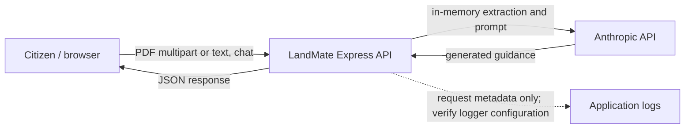

# Threat model and privacy map — DCIT 415 M7 draft

**Scope:** Browser client, Express API, transient uploaded text, generated
responses, and the external Anthropic API. This is a draft, not a penetration
test or a statement of Act 843 compliance.

## Data-flow sketch

## STRIDE risks

Risk score is a provisional `likelihood (1–5) × impact (1–5)` ranking. Team
security lead must reassess the scores and confirm controls.

| ID  | STRIDE / threat                                                                                            |    L×I | Mitigation / status                                                                                                                                                                                   |
| --- | ---------------------------------------------------------------------------------------------------------- | -----: | ----------------------------------------------------------------------------------------------------------------------------------------------------------------------------------------------------- |
| T1  | Spoofing: attacker impersonates a service endpoint or tampers with traffic.                                |  2×4=8 | HTTPS in production, trusted hosting, certificate validation; production deployment not yet verified.                                                                                                 |
| T2  | Tampering: crafted file or request changes parser behavior or content.                                     | 3×4=12 | 4 MB upload cap and memory storage exist; MIME+extension validation and malformed-file tests remain.                                                                                                  |
| T3  | Repudiation: actions cannot be correlated during incident response.                                        |  2×3=6 | Pino request logs omit bodies; define a privacy-safe request ID/retention policy and verify no document text is logged.                                                                               |
| T4  | Information disclosure: land document or personal identifiers leak via logs, browser storage, or provider. | 3×5=15 | No deliberate LandMate document persistence; use in-memory state, redact secrets, disclose provider processing, review logging and provider retention/terms.                                          |
| T5  | Denial of service: repeated uploads or AI calls consume API/AI capacity.                                   | 3×4=12 | File limit and 30 s AI timeout exist; per-IP rate limit, concurrency cap, and load test are pending.                                                                                                  |
| T6  | Elevation of privilege: unvalidated requests reach privileged routes or execute unintended actions.        | 2×5=10 | No land/financial write operations in MVP; validate request schemas and keep server secrets inaccessible to client; security scan pending.                                                            |
| T7  | Prompt injection: document text or chat asks the model to ignore system guidance.                          | 4×4=16 | Treat document text as untrusted input, keep system instructions server-side, constrain response format, test adversarial examples, and clearly label AI output. Robust prevention is not guaranteed. |
| T8  | Supply-chain compromise: malicious or vulnerable dependency enters build.                                  | 3×4=12 | Lockfile and pnpm minimum-release-age policy exist; CI dependency audit and review of high/critical findings pending.                                                                                 |
| T9  | Misleading guidance: stale or fabricated GLC fees/steps cause financial or legal harm.                     | 3×5=15 | Persistent disclaimer and official-verification instructions; cite dated official sources and add human review/evaluation before public use.                                                          |

## Act 843 data-mapping questions

| Data                                      | Source / purpose                     | Handling known from code                                                                              | Open compliance question                                                                                                                                                               |
| ----------------------------------------- | ------------------------------------ | ----------------------------------------------------------------------------------------------------- | -------------------------------------------------------------------------------------------------------------------------------------------------------------------------------------- |
| Uploaded land document and extracted text | Citizen-provided; explain or guide.  | PDF is held in multer memory and request text is sent to the AI provider; no LandMate document table. | Could contain names, addresses, signatures, parcel data, or other personal data. Establish lawful basis, notice/consent, processor terms, retention, and cross-border transfer review. |
| Chat question/history                     | Citizen-provided; contextual answer. | Sent in request context; client stores history in React memory for the current session.               | Limit history size, prevent log capture, and define deletion behavior.                                                                                                                 |
| IP address / request metadata             | Operational security.                | Express/Pino logs request metadata.                                                                   | Define access, retention, and minimisation; verify reverse-proxy behavior.                                                                                                             |
| Anthropic credential                      | Service secret.                      | Server environment only; client initialization is lazy.                                               | Configure secret manager, rotation, least privilege, and leak scanning.                                                                                                                |

Do not use real citizen documents in development, testing, or classroom demos.
Use synthetic or explicitly consented, redacted samples.
