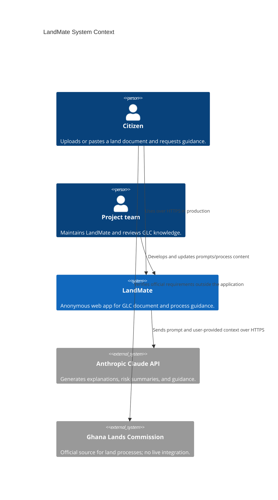
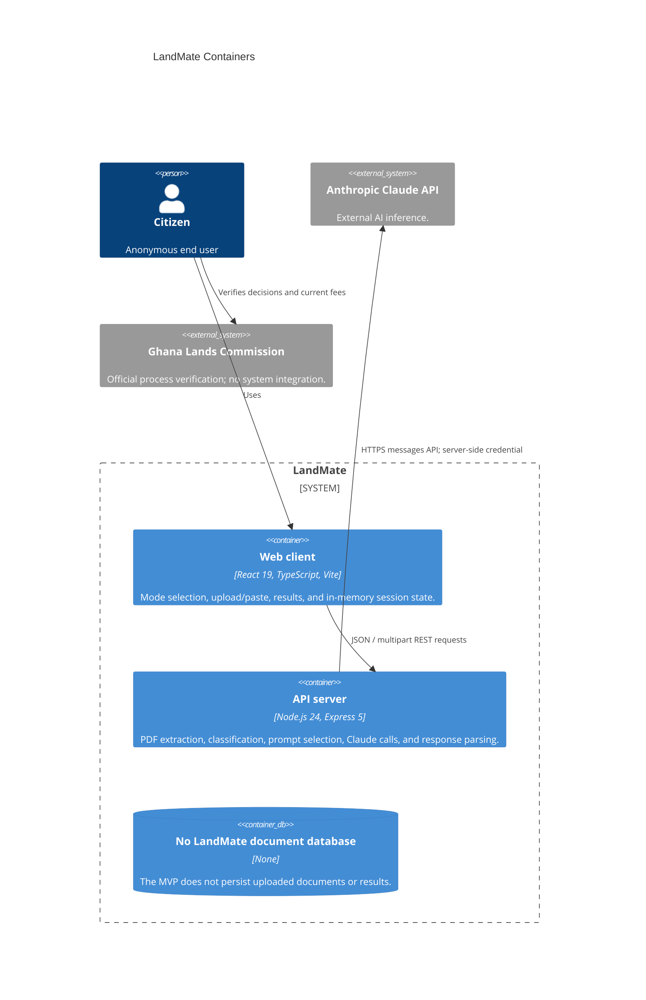
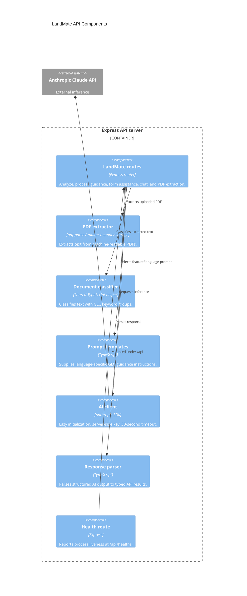

# LandMate architecture — DCIT 415 M2 draft

**Status:** Implementation-derived draft. Service availability assumptions are
illustrative, not measured SLOs.

## C4 Level 1 — system context

## C4 Level 2 — containers

## C4 Level 3 — API server

## Quality-attribute scenarios

| Attribute       | Stimulus                                             | Response / measurable target                                                                                                            | Verification                                                                |
| --------------- | ---------------------------------------------------- | --------------------------------------------------------------------------------------------------------------------------------------- | --------------------------------------------------------------------------- |
| Availability    | Anthropic is unavailable or times out.               | Return a safe, retryable API error within 30 seconds; retain client state.                                                              | Stub timeout/provider failure in integration tests.                         |
| Confidentiality | User uploads a document containing personal details. | Process in memory, do not log its body or persist a LandMate copy, and send only the request context needed to the configured provider. | Code/config review and upload test; obtain provider/data-protection review. |
| Performance     | A text-based PDF up to 5 MB is uploaded.             | Extract in ≤3 seconds on the agreed reference test environment.                                                                         | 20-run timed integration test; report p95 and environment.                  |
| Usability       | A citizen uses a 360 px mobile viewport.             | Complete a primary journey without horizontal scrolling or sub-44 px controls.                                                          | Browser E2E and manual mobile/accessibility audit.                          |

## Availability estimate (series path)

For the illustrative request path with independent components at 99.9%, 99.95%,
and 99.5% availability:

`A_series = 0.999 × 0.9995 × 0.995 = 0.993507975 = 99.3508%`.

If the weakest (99.5%) component is duplicated in parallel and failures are
independent:

`A_weak_pair = 1 - (1 - 0.995)^2 = 99.9975%`.

`A_total = 0.999 × 0.9995 × 0.999975 = 99.8476%`.

This is a classroom calculation, not LandMate's measured availability. The
external AI provider and user network are not controlled by this application.

## Architecture decision records

See [ADR-001](../adr/ADR-001-anonymous-client-session.md),
[ADR-002](../adr/ADR-002-server-side-ai-provider.md), and
[ADR-003](../adr/ADR-003-modular-monolith.md).
