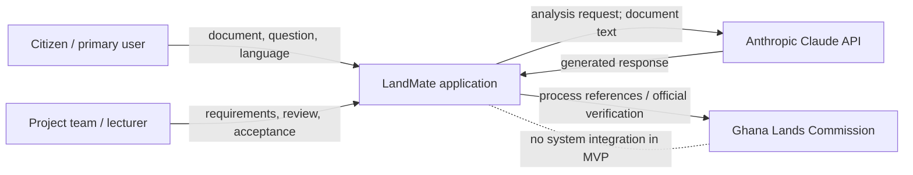

# LandMate requirements — DCIT 415 M1 draft

**Status:** Draft based on the existing LandMate SRS and code. Team, stakeholder,
lecturer-approval, and priority assumptions need review before submission.

## Stakeholders

| Stakeholder                                             | Need / concern                                                                           |
| ------------------------------------------------------- | ---------------------------------------------------------------------------------------- |
| Ghanaian land buyers and owners                         | Understand documents and processes in plain language; protect privacy.                   |
| First-time smartphone users                             | Simple mobile workflow, accessible language, useful recovery when extraction fails.      |
| Lands Commission process users                          | Current, clearly caveated process and fee guidance.                                      |
| Legal professionals / consumer-protection organisations | No misleading claims that AI output is legal advice.                                     |
| Anthropic API provider                                  | Proper API use, rate limits, secure credentials, and acceptable data handling.           |
| Project team and lecturer                               | Demonstrable requirements, traceability, quality evidence, and honest AI-use disclosure. |

## Scope and boundaries

The current proposal covers anonymous document explanation, red-flag
information, GLC process guidance, form help, and contextual Q&A in English,
Twi, and Pidgin. It is not a land registry, official GLC service, lawyer, title
verification service, or fraud determination. Users must be directed to an
official office or qualified lawyer for decisions. Uploaded content is sent to
the configured AI provider for requested analysis; the app does not intentionally
save it as a LandMate record.

The original SRS describes images/OCR as a desired capability, but image OCR is
not implemented. Current upload supports text and machine-readable PDFs only.
This is an explicit MVP gap, not a completed feature.

## User stories and acceptance criteria

1. **Understand a document.** As a land buyer, I want a plain-language document
   explanation so I can identify its main terms.
   - Given a supported document and Explain mode, when analysis succeeds, then
     I see a summary, key points, dates, next steps, and the legal disclaimer.
   - Given empty text, when I continue, then analysis is blocked and I am asked
     to add document content.
2. **Check possible risks.** As a prospective signer, I want potential warning
   signs highlighted so I know what to verify.
   - Given a document and Red Flags mode, when analysis succeeds, then each
     returned flag includes a severity, explanation, and recommendation.
   - Given no returned flags, when results render, then I am not told that the
     document is legally safe and am advised to seek official verification.
3. **Choose a language.** As a citizen, I want to select English, Twi, or Pidgin
   so guidance is easier to understand.
   - Given a selected language, when I request guidance, then the API receives
     that language.
   - Given an unsupported language value, when the API validates the request,
     then it rejects the input rather than silently accepting it.
4. **Upload a PDF.** As a user with a digital land document, I want to extract
   its text without storing the file.
   - Given a machine-readable PDF no larger than 10 MB, when I upload it, then
     extracted text is returned for the current browser session.
   - Given an oversized, unsupported, or unreadable file, when I upload it,
     then I receive a clear error and a paste-text alternative.
5. **Paste document text.** As a user with a paper document, I want to paste
   text so I can still get help.
   - Given non-empty pasted text, when I continue, then the app classifies it
     and submits it for the selected mode.
   - Given text with fewer than two matching GLC classification keywords, when
     classification runs, then its type is `unknown`.
6. **Find a GLC process.** As a land owner, I want to search process options so
   I can find a relevant guide.
   - Given a query, when I type, then matching process names/descriptions are
     shown without a page reload.
   - Given no matching process, when results update, then an empty-state
     message is displayed.
7. **Get a process guide.** As a citizen, I want ordered steps and document
   requirements so I can prepare for a GLC visit.
   - Given one selected process, when I request guidance, then I see numbered
     steps and any returned documents, duration, offices, and fees.
   - Given an AI/API failure, when the request fails, then my selection remains
     available and the UI presents a retry path.
8. **Get form help.** As an applicant, I want field-level form explanations so
   I can understand what information is requested.
   - Given form text, when assistance succeeds, then field instructions,
     examples, and common mistakes are shown where available.
   - Given unreadable or empty form content, when I request help, then I receive
     a clear recovery message rather than fabricated field data.
9. **Ask a follow-up.** As a user, I want to ask questions about the document
   just analyzed so I can clarify an unfamiliar clause.
   - Given a non-empty question, when I send it, then it is answered with the
     available document context and conversation history.
   - Given an empty or over-limit question, when I send it, then the request is
     rejected with a clear validation message.
10. **Start a new session.** As a privacy-conscious user, I want to clear my
    current work so it is not shown to the next person using my device.
    - Given results or chat history, when I choose New Session, then document
      text, results, selected mode/process, and conversation history are cleared.
    - Given a new session, when I reload the home page, then no previous
      analysis is restored.
11. **Understand limitations.** As a user, I want to know this is not legal
    advice so I do not mistake AI output for an official decision.
    - Given any result mode, when its results render, then a legal disclaimer is
      visible.
    - Given a question asking for litigation advice, when answered, then the
      system directs the user to a qualified lawyer.
12. **Use a mobile screen.** As a citizen using a phone, I want the core journey
    to work at 360 px width so I do not need a computer.
    - Given a 360 px viewport, when I complete mode selection and document
      input, then the page has no horizontal overflow.
    - Given a keyboard or screen-reader user, when focus moves through controls,
      then controls have accessible names and visible focus (verification
      pending).

## Measurable non-functional requirements (draft targets)

These are proposed acceptance thresholds from the original SRS. They are not
claims of measured performance; collect and attach evidence before submission.

| ID     | ISO/IEC 25010 characteristic | Metric / target                                                                   | Conditions and verification                                                           |
| ------ | ---------------------------- | --------------------------------------------------------------------------------- | ------------------------------------------------------------------------------------- |
| NFR-01 | Performance efficiency       | Processing view appears within 500 ms.                                            | 360 px mobile viewport; 20 cold and 20 warm runs; browser performance trace.          |
| NFR-02 | Performance efficiency       | 95% of AI calls return parsed output within 10 s.                                 | Test provider/network and capped representative payload; record p95.                  |
| NFR-03 | Performance efficiency       | PDF text extraction finishes within 3 s.                                          | 5 MB text PDF; 20 runs; time API request.                                             |
| NFR-04 | Usability                    | No horizontal overflow at viewport widths ≥360 px.                                | Chrome Android/Safari iOS emulation; automated viewport test plus manual check.       |
| NFR-05 | Usability / accessibility    | WCAG AA contrast: ≥4.5:1 normal text, ≥3:1 large text; touch targets ≥44×44 px.   | Automated accessibility scan and design-system audit.                                 |
| NFR-06 | Reliability                  | AI timeout at 30 s returns a user-safe failure and retains the current document.  | Stub a slow/failing provider; verify API deadline and UI recovery.                    |
| NFR-07 | Security / privacy           | Uploaded file buffers are not written to local disk or a LandMate document table. | Code inspection and filesystem/DB observation during upload test.                     |
| NFR-08 | Security                     | Reject non-PDF upload with mismatched extension/MIME and files >10 MB.            | Multipart integration tests for valid, mismatched, unsupported, and oversized inputs. |

## Prioritised backlog (provisional)

MoSCoW is a draft. The WSJF inputs use a provisional 1–10 team scale:
`WSJF = (user/business value + time criticality + risk reduction) / job size`.
The product owner must replace these estimates with team-agreed scores.

| Item                                   | MoSCoW | Value | Time | Risk | Size | WSJF |
| -------------------------------------- | -----: | ----: | ---: | ---: | ---: | ---: |
| PDF/text explanation journey           |   Must |    10 |    9 |    8 |    5 |  5.4 |
| AI keys remain server-only             |   Must |     8 |    9 |   10 |    3 |  9.0 |
| Privacy and legal disclaimers          |   Must |     9 |    8 |   10 |    3 |  9.0 |
| Red-flag review journey                |   Must |     9 |    8 |    8 |    5 |  5.0 |
| GLC process guide                      |   Must |     8 |    7 |    6 |    4 | 5.25 |
| API input/upload validation            |   Must |     8 |    7 |    9 |    5 |  4.8 |
| Form assistance                        | Should |     7 |    5 |    4 |    5 |  3.2 |
| Follow-up chat with document context   | Should |     7 |    5 |    5 |    6 | 2.83 |
| PDF extraction recovery/paste fallback |   Must |     8 |    8 |    7 |    3 | 7.67 |
| Mobile/accessibility verification      |   Must |     8 |    7 |    6 |    5 |  4.2 |
| OCR for scanned images                 |  Could |     5 |    3 |    3 |    8 | 1.38 |
| Shareable plain-text summary           |  Could |     4 |    3 |    2 |    3 |  3.0 |

## Context map

## Known SRS-to-code gaps

- Images are not OCR-processed; the UI/API reject them.
- Chat length is truncated server-side, but request schema validation and
  explicit over-limit feedback are not yet consistent.
- PDF type acceptance currently needs MIME and extension validation.
- Several SRS result-view details and chat behaviors require acceptance tests.
- Process duration/cost figures are currently hard-coded and need verification
  with official GLC sources and a review date.
- The backend uses a 1,000-token output cap in accordance with the original
  SRS; longer guides may be truncated and need a UI warning/retry strategy.
- Lecturer approval, project stakeholders, team, and scoring assumptions must
  be confirmed by the team.
